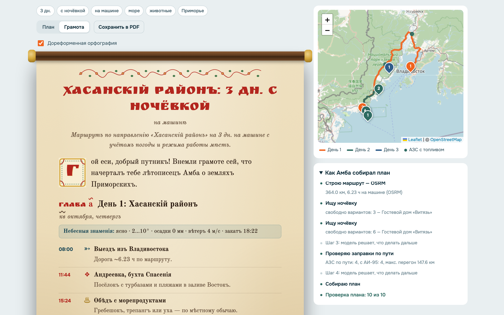
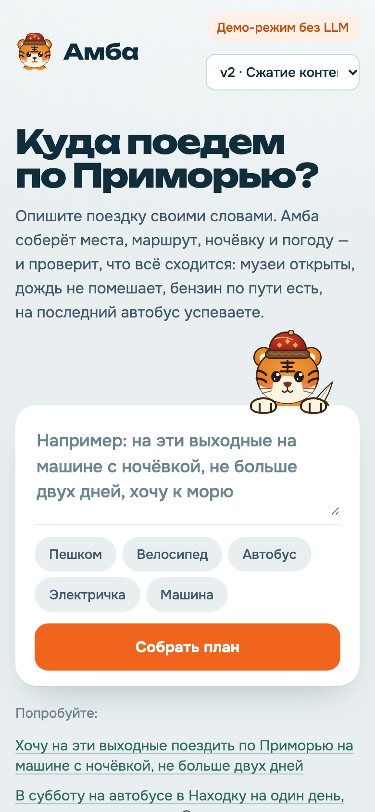
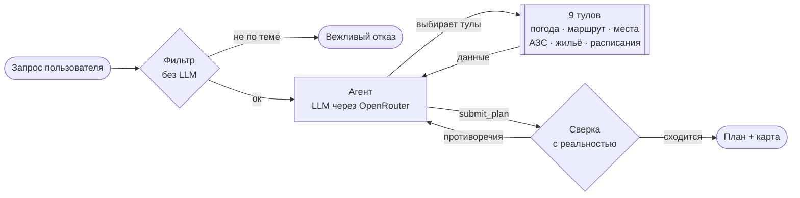

<p align="center"></p>

<p align="center">
  
  
  
  
  
</p>

**Амба** — веб-ассистент для поездок по Приморскому краю. Пишете запрос обычными словами, например
«на выходные на машине с ночёвкой, не больше двух дней», и получаете готовый план: места, маршрут по дорогам,
ночёвку, погоду и что учесть. Перед тем как показать план, агент **сверяет его с реальностью**: открыты ли места
в эти дни, не льёт ли дождь на велопрогулку, есть ли бензин по пути, успеваете ли на последний автобус.

Маскот — амурский тигрёнок Амба. Командный проект Т-Банк × Сириус.

<p align="center"></p>

## Возможности

- **Агент, а не один промпт.** Модель сама выбирает из 9 тулов, вызывает их (независимые — параллельно), собирает план и исправляет его, если сверка нашла противоречия.
- **Реальные данные.** Погода — Open-Meteo, маршруты — OSRM, геокодер — Nominatim, АЗС — OSM Overpass, справки — Википедия.
- **Ограничения транспорта.** Пешком ≤ 20 км в день и до заката, велосипед ≤ 80 км и не под дождём, автобус — строго по расписанию, машина — заправки на длинных перегонах.
- **Только Приморье.** Другие регионы, посторонние задачи и попытки сменить правила вежливо отклоняются; очевидные — без вызова модели.
- **Карта маршрута** на OpenStreetMap по дням, шаги агента видны вживую.
- **Два вида плана:** современный и «Грамота» — тот же план в виде старорусской рукописи.

<table>
  <tr>
    <td width="50%"></td>
    <td width="25%"></td>
    <td width="25%"></td>
  </tr>
  <tr>
    <td align="center">Режим «Грамота»</td>
    <td align="center" colspan="2">Телефон</td>
  </tr>
</table>

## Как это работает



| Тул | Что делает | Источник |
|---|---|---|
| `get_weather` | прогноз по дням: осадки, ветер, закат | **Open-Meteo** |
| `build_route` | маршрут на машине, велосипеде, пешком | **OSRM** (OpenStreetMap) |
| `geocode` | координаты места в Приморье | **Nominatim** + справочник |
| `find_fuel_stations` | АЗС вдоль маршрута, самый длинный перегон без топлива | **Overpass** + мок наличия бензина |
| `place_info` | справка о месте | **Википедия** |
| `search_places` | 41 место Приморья с режимом работы | датасет |
| `find_lodging` | ночёвка рядом, цена, свободные места | мок |
| `public_transport` | автобусы, электрички, паромы | датасет |
| `find_events` | ярмарки, спектакли, кормление тигров | датасет |

Если внешний API не отвечает, тул не падает: переключается на офлайн-оценку и сообщает об этом агенту.

### Сверка плана

Валидатор ([`backend/app/validator.py`](backend/app/validator.py)) не зависит от модели и проверяет: лимит дней и даты,
способ передвижения, ночёвку на каждую ночь, режим работы мест, что все точки в Приморье, прогноз погоды и закат,
дневной километраж, заправки для машины, рейсы для автобуса. В версиях v2 и v3 найденные противоречия возвращаются
агенту, и он исправляет план.

## Замеры

Три версии пайплайна на одном фиксированном наборе запросов ([`eval/queries.json`](eval/queries.json)):

| | v1 — бейзлайн | v2 — улучшенная | v3 — финальная |
|---|---|---|---|
| Промпт | короткий | подробный: правила, ограничения транспорта | как v2 |
| Контекст | сырые ответы тулов | сжатие: только нужные поля | как v2 |
| Фильтр запросов | нет | до вызова модели | как v2 |
| Сверка | только показывается | ошибки уходят агенту на исправление | как v2 |
| Модель | MiniMax M3.1 Flash | MiniMax M3.1 Flash | DeepSeek V4.1 Flash |

<!-- EVAL:START -->
10 запросов: 7 поездок разными видами транспорта и 3 нецелевых.

| Вариант | Модель | Качество | Тул верный | Интент (сверка) | План сходится | Guardrails | Токены / запрос | $ / запрос | Время, с (ср / p50) |
|---|---|---|---|---|---|---|---|---|---|
| v1 · Бейзлайн | `minimax/minimax-m3.1-flash:free` | **0.64** | 70% | 0.55 | 43% | 67% | 87 860 | 0.0000 | 68.47 / 67.03 |
| v2 · Сжатие контекста + сверка | `minimax/minimax-m3.1-flash:free` | **0.75** | 80% | 0.57 | 57% | 100% | 52 098 | 0.0000 | 65.65 / 65.07 |
| v3 · Финальная: v2 + исправления + DeepSeek | `deepseek/deepseek-v4.1-flash` | **1.00** | 100% | 1.00 | 100% | 100% | 32 462 | 0.0052 | 50.54 / 22.79 |

**Итог:** сжатие контекста срезало токены на 41% (v1 → v2), фильтр довёл отказы до 100%, а исправления, найденные эвалом, и DeepSeek довели долю сходящихся планов с 43% до 100% при $0.005 за запрос. Подробно — [`eval/results`](eval/results).
<!-- EVAL:END -->

**Качество** = 0,5 × «верный тул» + 0,5 × доля пройденных проверок сверки. «Верный тул» — агент вызвал все
обязательные для запроса тулы, а на нецелевой запрос отказал, не собирая данных.
**Стоимость** — токены и $ из ответа OpenRouter. **Скорость** — время от запроса до готового плана.

## Запуск

```bash
make install                # окружение и зависимости
cp .env.example .env        # впишите OPENROUTER_API_KEY
make dev                    # http://localhost:8000
```

Без ключа приложение работает в демо-режиме: тот же агентный цикл и те же тулы, но вместо модели — правила.

**Живое демо:** https://amba-production-3ab7.up.railway.app

```bash
make test                   # pytest + тесты фронта
make eval                   # замеры v1, v2, v3 → eval/results/summary.md
./deploy/deploy.sh user@IP  # Docker на сервере → http://IP:8000
```

**Railway:** New Project → Deploy from GitHub repo → этот репозиторий; в Variables добавить `OPENROUTER_API_KEY`;
в Settings → Networking нажать Generate Domain. Сборка по `Dockerfile` и `railway.json`, каждый пуш в `main` — новый деплой.

## Тесты

| Набор | Тестов | Что покрывает |
|---|---|---|
| `backend/tests` | 89 | интенты, фильтр, все тулы (внешние API замоканы), сверка, агентный цикл, API и стрим, клиент OpenRouter, метрики |
| `frontend/tests` | 14 | рендер плана и грамоты, даты, экранирование HTML |
| `e2e` | 4 | настоящий браузер: запрос → план → карта, переключение вида, отказ, телефон |

## Структура

```
backend/app/     агент, тулы, сверка, фильтр, клиент OpenRouter, API
frontend/        HTML, CSS, JS без сборки; Амба — frontend/assets/amba.svg
eval/            запросы, прогон замеров, результаты
presentation/    генератор презентации → Amba_Travel_AI.pptx
docs/            отчёт, скриншоты
deploy/          деплой на сервер
```

## Команда

| | Роль |
|---|---|
| Саша Дё | Backend developer |
| Анфиса Кирсанова | ML-engineer / Frontend developer |
| Ксюша Яковлева | ML-engineer / Frontend developer |
| Глеб Бессолицин | Backend developer |
| Арнольд Гончаров | QA-engineer |
| Opus 5.5 | Team Lead |
| Luna 6 | Debug-engineer |
