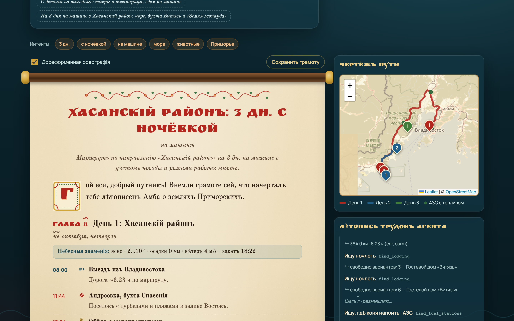
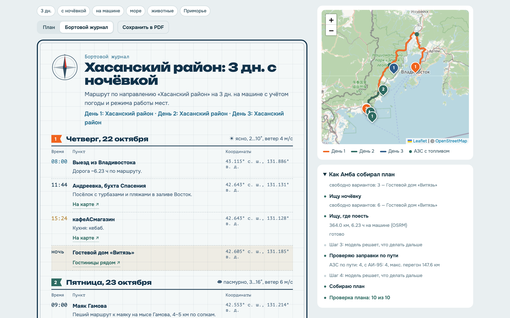
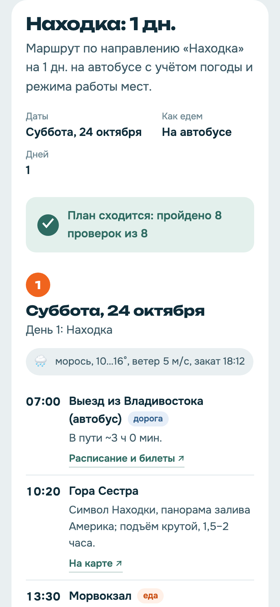
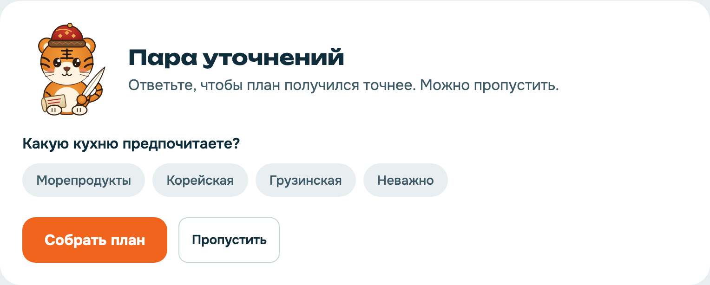
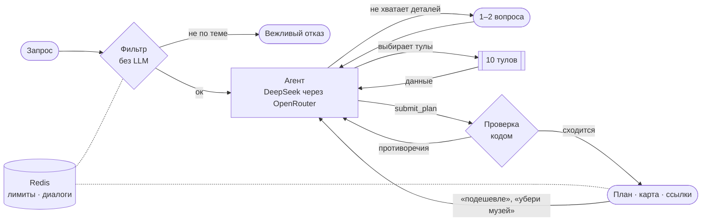
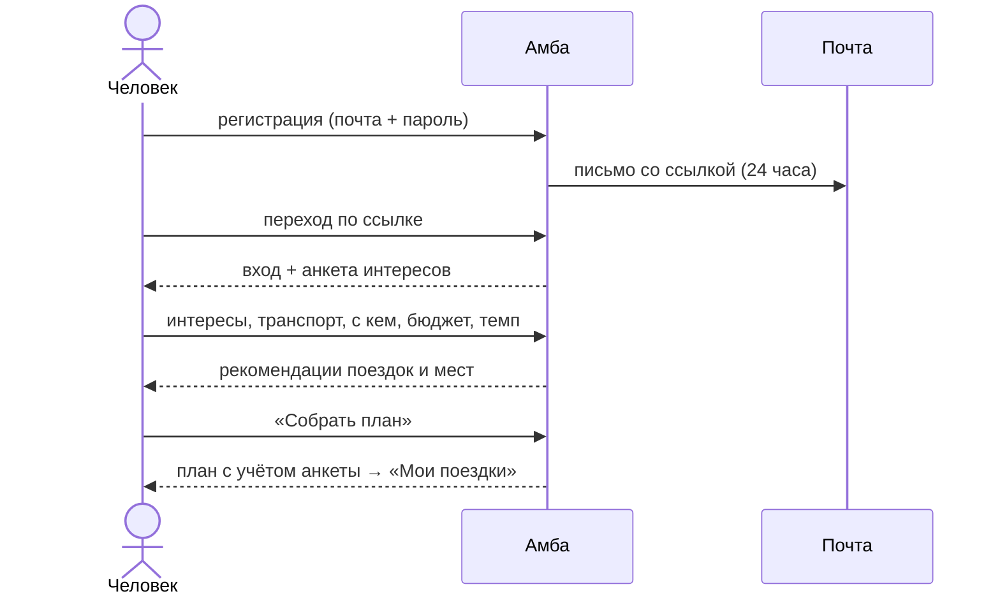
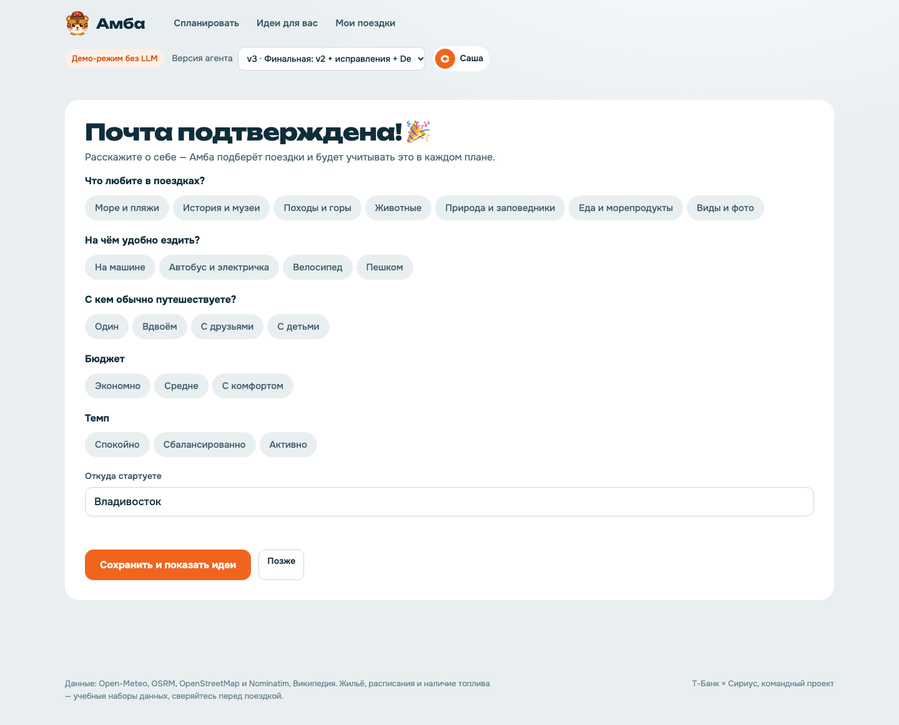
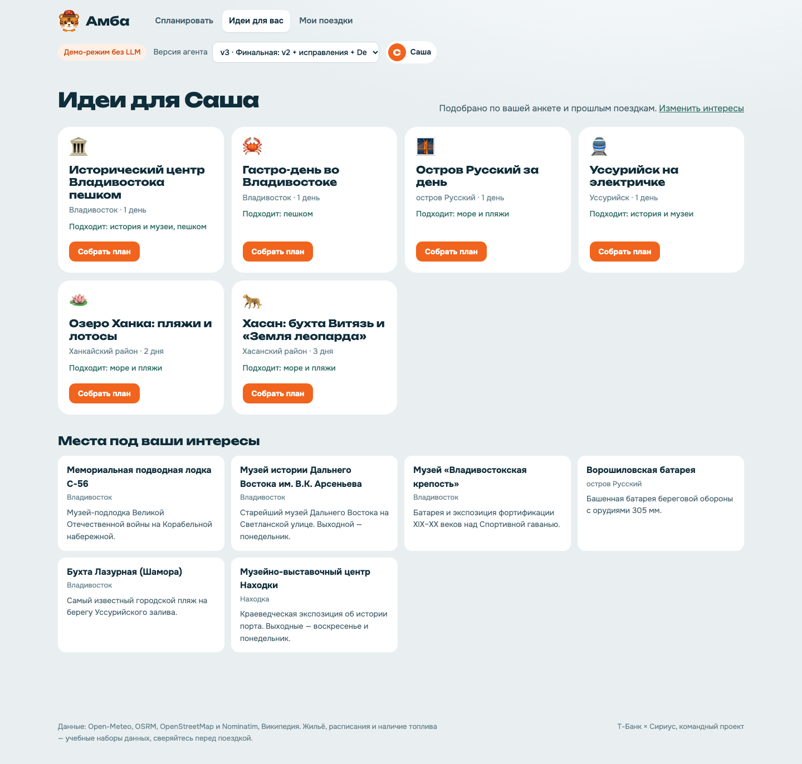

<p align="center"></p>

<h3 align="center">Пишете поездку обычными словами — агент собирает план и проверяет, что он сходится с реальностью</h3>

<p align="center">
  <a href="https://amba-production-3ab7.up.railway.app"></a>
  <a href="https://bessolitsingleb.github.io/AI-ta/site/"></a>
  
  
  
  
</p>

<p align="center">
  <a href="#-возможности">Возможности</a> ·
  <a href="#-как-это-работает">Как работает</a> ·
  <a href="#-аккаунты">Аккаунты</a> ·
  <a href="#-замеры">Замеры</a> ·
  <a href="#-быстрый-старт">Быстрый старт</a> ·
  <a href="#-команда">Команда</a>
</p>

---

<table>
<tr>
<td width="62%"></td>
<td width="38%">

**Запрос:** «На 3 дня на машине в Хасанский район: море, бухта Витязь и „Земля леопарда“, с ночёвкой»

**Амба:**
- уточнит, что важно, если не хватает деталей
- соберёт места, маршрут по дорогам, ночёвку, кафе и погоду
- проверит план: режим работы, закат, дожди, заправки, рейсы
- даст ссылки, чтобы сразу всё оформить

</td>
</tr>
</table>

## ✨ Возможности

| | |
|---|---|
| 🧠 **Настоящий агент** | Модель сама выбирает из 10 тулов, вызывает их параллельно и собирает план. Цикл написан с нуля, без фреймворков |
| ✅ **План сходится** | Код (не модель) проверяет сроки, режим работы мест, погоду и закат, дневной километраж, заправки и расписания. Противоречия агент обязан исправить |
| 🗺️ **Маршрут по улицам** | Карта OpenStreetMap по дням: дороги, тропы, пешие маршруты — не «по прямой через дома» |
| 🦀 **Реальные кафе** | Заведения из OpenStreetMap с кухней, часами работы и сайтом |
| 🔗 **Ссылки «оформить»** | Яндекс Карты и сайты, расписания и билеты на Яндекс Расписаниях, гостиницы рядом |
| 💬 **Короткий диалог** | Если важного не хватает, задаст 1–2 вопроса с готовыми вариантами ответа |
| 🔁 **Доработка в чате** | «Подешевле», «убери музей», «давай на электричке» — агент меняет только то, что просят, и снова проверяет план. История диалога — в Redis |
| 🚦 **Защита от спама** | Лимиты запросов в Redis: на планы, вход и письма. Нет Redis — работает на памяти и не падает |
| 🛡️ **Только Приморье** | Другие регионы, оффтоп и «забудь правила» отклоняются, очевидные случаи — без вызова модели |
| 👤 **Аккаунты** | Регистрация с подтверждением почты, анкета интересов, история поездок и рекомендации |
| ⚓ **Два вида плана** | Обычный и «Бортовой журнал» в морском стиле |

<table>
<tr>
<td width="50%"></td>
<td width="25%"></td>
<td width="25%"></td>
</tr>
<tr>
<td align="center">«Бортовой журнал»</td>
<td align="center">Телефон</td>
<td align="center">Уточняющие вопросы</td>
</tr>
</table>

## 🔄 Как это работает



<details>
<summary><b>10 тулов и источники данных</b></summary>

| Тул | Что делает | Источник |
|---|---|---|
| `get_weather` | прогноз по дням: осадки, ветер, закат | **Open-Meteo** |
| `build_route` | маршрут на машине, велосипеде, пешком | **OSRM** (OpenStreetMap) |
| `find_food` | реальные кафе: кухня, часы, сайт | **OpenStreetMap / Nominatim** |
| `geocode` | координаты места в Приморье | **Nominatim** |
| `find_fuel_stations` | АЗС вдоль маршрута и самый длинный перегон | **Overpass** + учебные данные о топливе |
| `place_info` | справка о месте | **Википедия** |
| `search_places` | 41 место Приморья с часами работы | свой набор данных |
| `find_lodging` | ночёвка рядом, цена, свободные места | учебные данные |
| `public_transport` | автобусы, электрички, паромы | свой набор данных |
| `find_events` | ярмарки, спектакли, кормление тигров | свой набор данных |

Если сервис недоступен, тул не падает: переходит на оценку и сообщает об этом агенту.
</details>

<details>
<summary><b>Что проверяет код</b></summary>

- лимит дней и даты из запроса, ночёвка на каждую ночь;
- место открыто в этот день и час;
- все точки внутри Приморского края;
- погода: велосипед и пешком — не в дождь и ветер, уличные места — до заката;
- пешком ≤ 20 км в день, велосипед ≤ 80 км;
- машина — есть АЗС с топливом на длинном маршруте;
- автобус — рейс существует, ходит в этот день, успеваем на последний.
</details>

## 👤 Аккаунты



- **Вход:** короткий access-токен JWT (15 минут) и refresh-токен (30 дней) в httpOnly-cookie. Refresh одноразовый: при каждом обновлении выдаётся новый, а повторное использование старого завершает все сессии.
- **Почта:** письма через Gmail SMTP с паролем приложения. Пока пароль не задан, письма пишутся в лог сервера.
- **Безопасность:** пароли в bcrypt, ссылка сброса пароля одноразовая, смена пароля выходит со всех устройств, лимиты попыток, по ответам нельзя узнать, есть ли такая почта, чужие поездки недоступны.
- **Анкета → агент:** интересы и предпочтения из профиля сразу уходят агенту, чтобы он не переспрашивал.
- **История:** каждый план сохраняется в «Мои поездки» и открывается заново без повторных трат.

<table>
<tr>
<td width="50%"></td>
<td width="50%"></td>
</tr>
<tr><td align="center">Анкета интересов</td><td align="center">Идеи для вас</td></tr>
</table>

<details>
<summary><b>API</b></summary>

| Метод | Путь | Что делает |
|---|---|---|
| `POST` | `/api/auth/register` | регистрация, письмо со ссылкой |
| `GET` | `/api/auth/verify?token=` | подтверждение почты и вход |
| `POST` | `/api/auth/resend` | повторное письмо |
| `POST` | `/api/auth/login` | вход: access-токен + refresh-cookie |
| `POST` | `/api/auth/refresh` | новый access-токен, ротация refresh |
| `POST` | `/api/auth/logout` | выход |
| `POST` | `/api/auth/forgot` · `/api/auth/reset` | сброс пароля по письму |
| `GET` `PATCH` `DELETE` | `/api/me` | профиль и анкета, удаление аккаунта |
| `POST` | `/api/me/password` | смена пароля |
| `GET` | `/api/recommendations` | поездки и места по анкете |
| `GET` `PATCH` `DELETE` | `/api/trips[/id]` | история поездок, избранное |
| `POST` | `/api/plan` · `/api/plan/stream` | собрать план (стрим шагов агента); с `conversation_id` — доработать план в диалоге |
</details>

## 📊 Замеры

Три версии агента на одном фиксированном наборе: 7 поездок разным транспортом и 3 нецелевых запроса.

| Вариант | Модель | Качество | Тул верный | Интент (сверка) | План сходится | Guardrails | Токены / запрос | $ / запрос | Время, с (ср / p50) |
|---|---|---|---|---|---|---|---|---|---|
| v1 · Бейзлайн | `minimax/minimax-m3.1-flash:free` | **0.64** | 70% | 0.55 | 43% | 67% | 87 860 | 0.0000 | 68.47 / 67.03 |
| v2 · Сжатие контекста + сверка | `minimax/minimax-m3.1-flash:free` | **0.75** | 80% | 0.57 | 57% | 100% | 52 098 | 0.0000 | 65.65 / 65.07 |
| v3 · Финальная: v2 + исправления + DeepSeek | `deepseek/deepseek-v4.1-flash` | **1.00** | 100% | 1.00 | 100% | 100% | 32 462 | 0.0052 | 50.54 / 22.79 |

> Качество выросло с **0.64** до **1.00**, планов со всеми пройденными проверками — с **43%** до **100%**, токенов стало на **63%** меньше. Замеры нашли три настоящих бага агента — все исправлены в v3.

**Качество** = 0,5 × «верно выбраны тулы» + 0,5 × доля пройденных проверок плана.

## 🚀 Быстрый старт

**Docker** — самый простой способ:

```bash
git clone https://github.com/BessolitsinGleb/AI-ta.git && cd AI-ta
cp .env.example .env        # впишите OPENROUTER_API_KEY и JWT_SECRET
docker compose up -d --build
```

Поднимутся два контейнера: приложение и Redis. Откройте **http://localhost:8000**. Без ключа OpenRouter работает демо-режим на правилах.

Чтобы открыть Амбу с телефонов в той же Wi-Fi-сети, запустите `make lan`: скрипт сам найдёт IP ноутбука, пропишет его в ссылки из писем и в QR «Приложение» на 11-м слайде презентации, покажет адрес и QR-код.

<details>
<summary><b>Без Docker</b></summary>

```bash
make install    # окружение и зависимости
make dev        # http://localhost:8000
make test       # pytest + тесты фронта
make eval       # замеры трёх версий → eval/results
```
</details>

<details>
<summary><b>Переменные окружения</b></summary>

| Переменная | Зачем |
|---|---|
| `OPENROUTER_API_KEY` | ключ модели |
| `JWT_SECRET` | секрет подписи токенов, длинная случайная строка |
| `PUBLIC_URL` | адрес сайта для ссылок в письмах |
| `SMTP_USER`, `SMTP_PASSWORD`, `MAIL_FROM` | Gmail и пароль приложения для писем |
| `COOKIE_SECURE` | `1` на проде с HTTPS |
| `DATABASE_URL` | по умолчанию SQLite в `data/amba.db` |
| `REDIS_URL` | лимиты и диалоги; в Docker задаётся сам, без него — память процесса |
| `PLAN_LIMIT_PER_MIN`, `PLAN_LIMIT_PER_HOUR`, `PLAN_LIMIT_USER_PER_HOUR` | лимиты планов на IP и на пользователя |
| `MODEL_V1…V3`, `AGENT_VERSION` | модели и версия агента |
</details>

<details>
<summary><b>Деплой</b></summary>

- **Railway:** `railway up` — сборка по `Dockerfile` и `railway.json`.
- **Render:** New → Blueprint → этот репозиторий, настройки в `render.yaml`.
- **Своя VM:** `./deploy/deploy.sh user@IP` — Docker на сервере, `http://IP:8000`.
</details>

## 🧪 Тесты

| Набор | Тестов | Что покрывает |
|---|---|---|
| `backend/tests` | 126 | тулы (внешние API замоканы), проверка плана, агентный цикл, API и стрим, фильтр, Redis-лимиты и диалоги (fakeredis), аккаунты: регистрация, почта, JWT-сессии, сброс пароля, анкета, история, рекомендации |
| `frontend/tests` | 8 | рендер плана и журнала, ссылки, вопросы, экранирование |
| `e2e` | 8 | настоящий браузер: запрос → вопросы → план со ссылками → карта; регистрация → письмо → анкета → идеи → поездка сохранена → профиль; доработка плана в чате |

## 🗂️ Структура

```
backend/app/
  agent.py        агентный цикл, версии v1–v3
  tools/          10 тулов и наборы данных Приморья
  validator.py    проверка плана с реальностью
  accounts.py     регистрация, JWT, профиль, поездки, рекомендации
  dialog.py       доработка плана в диалоге, история в Redis
  store.py        Redis (лимиты, диалоги) с запасным хранением в памяти
  db.py           модели SQLAlchemy
  recommend.py    подбор поездок по анкете
frontend/         HTML, CSS, JS без сборки; Амба — frontend/assets/amba.svg
eval/             запросы, прогон замеров, результаты
presentation/     генераторы презентаций (в том числе в шаблоне Т-Банк Образование)
docs/             отчёт, текст выступления, скриншоты
```

## 👥 Команда

<table>
<tr>
<td align="center"><b>Opus 5.5</b><br><sub>Team Lead</sub></td>
<td align="center"><b>Саша Дё</b><br><sub>Backend developer</sub></td>
<td align="center"><b>Глеб Бессолицин</b><br><sub>Backend developer</sub></td>
<td align="center"><b>Анфиса Кирсанова</b><br><sub>ML / Frontend</sub></td>
</tr>
<tr>
<td align="center"><b>Ксюша Яковлева</b><br><sub>ML / Frontend</sub></td>
<td align="center"><b>Арнольд Гончаров</b><br><sub>QA-engineer</sub></td>
<td align="center"><b>Luna 6</b><br><sub>Debug-engineer</sub></td>
<td align="center"><br><sub>и Амба 🐯</sub></td>
</tr>
</table>

<p align="center"><sub>Т-Банк × Сириус · командный проект</sub></p>
