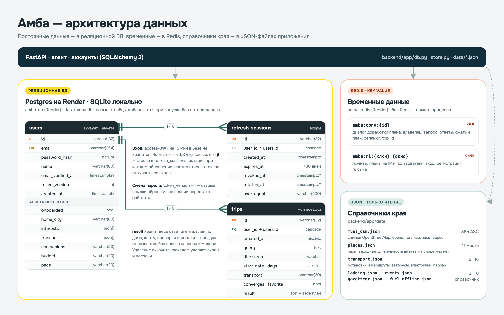
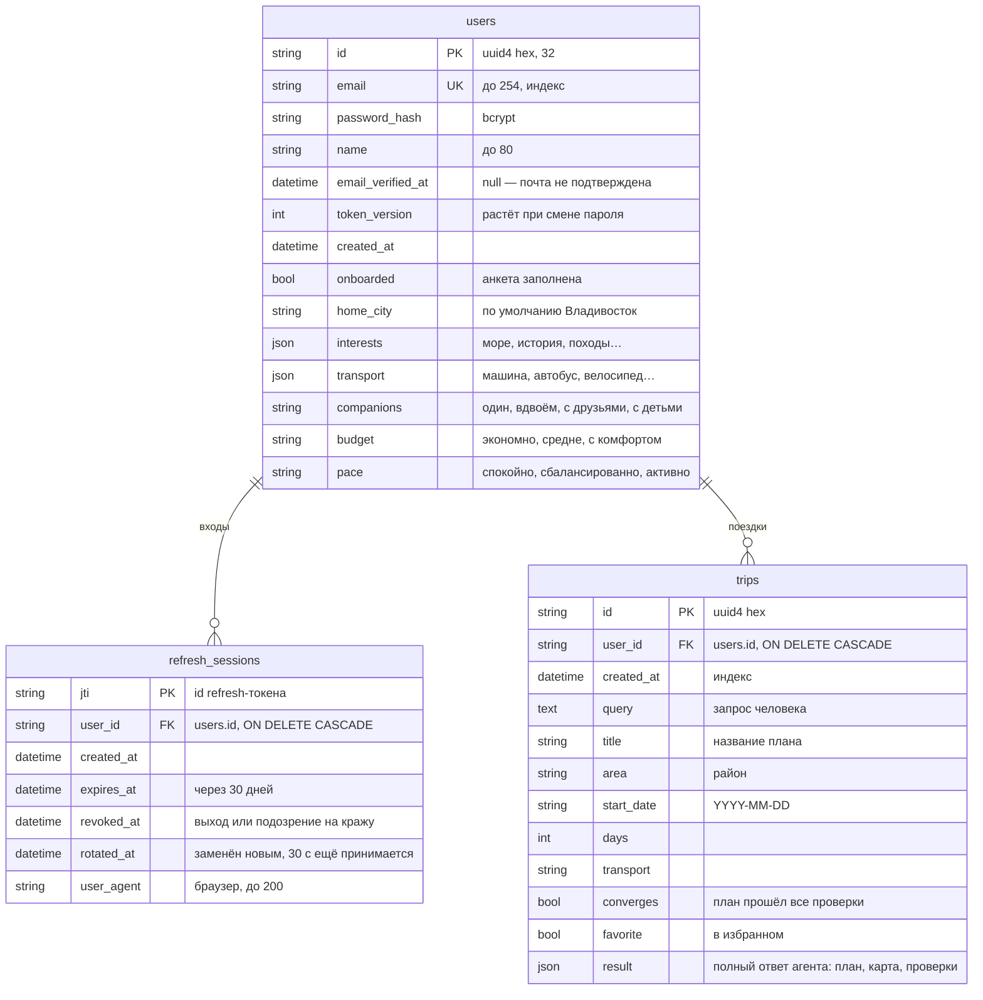

# Данные Амбы: база, Redis и наборы данных

Исходник схемы — [`db-architecture.html`](db-architecture.html), картинка пересобирается скриншотом страницы 1600×1000.

Где что хранится:

| Хранилище | Что лежит | Где |
|---|---|---|
| **Реляционная БД** | пользователи, сессии входа, сохранённые поездки | Postgres `amba-db` на Render, локально SQLite `data/amba.db` |
| **Redis** | лимиты запросов, диалоги доработки плана | Key Value `amba-redis` на Render; без Redis — память процесса |
| **JSON-наборы** | места, жильё, расписания, события, АЗС, справочник районов | `backend/app/data/*.json`, только чтение |

Модели описаны в `backend/app/db.py` (SQLAlchemy 2). Таблицы создаются при запуске, а новые столбцы
добавляются сами (`_add_missing_columns`), так что данные при обновлении не теряются.

## Схема БД

### `users` — пользователи и анкета интересов

| Поле | Тип | Зачем |
|---|---|---|
| `id` | `varchar(32)`, PK | uuid4 без дефисов |
| `email` | `varchar(254)`, уникальный, индекс | логин; хранится в нижнем регистре |
| `password_hash` | `varchar(100)` | bcrypt, сам пароль не хранится |
| `name` | `varchar(80)` | как обращаться |
| `email_verified_at` | `timestamptz`, null | когда подтвердил почту; на Render ставится сразу при регистрации (`EMAIL_VERIFY=0`) |
| `token_version` | `int` | при смене пароля +1: старые ссылки сброса и все сессии перестают работать |
| `created_at` | `timestamptz` | дата регистрации |
| `onboarded` | `bool` | анкета заполнена |
| `home_city` | `varchar(80)` | откуда стартует, по умолчанию Владивосток |
| `interests` | `json` (список) | интересы из анкеты |
| `transport` | `json` (список) | на чём удобно ездить |
| `companions`, `budget`, `pace` | `varchar(20)` | с кем, бюджет, темп |

Анкета сразу уходит агенту в каждом запросе, чтобы он не переспрашивал, и по ней строятся «Идеи для вас».

### `refresh_sessions` — входы (refresh-токены)

| Поле | Тип | Зачем |
|---|---|---|
| `jti` | `varchar(32)`, PK | id токена, записан внутри JWT |
| `user_id` | FK → `users.id`, каскадное удаление | чей вход |
| `created_at`, `expires_at` | `timestamptz` | срок жизни — 30 дней (`REFRESH_TTL_DAYS`) |
| `revoked_at` | `timestamptz`, null | отозван: выход, смена пароля или повторное использование старого токена |
| `rotated_at` | `timestamptz`, null | заменён новым при обновлении; ещё 30 с принимается от соседней вкладки |
| `user_agent` | `varchar(200)` | браузер, с которого вошли |

Access-токен (JWT на 15 минут) в базе не хранится — только refresh в httpOnly-cookie.

### `trips` — сохранённые поездки

| Поле | Тип | Зачем |
|---|---|---|
| `id` | `varchar(32)`, PK | |
| `user_id` | FK → `users.id`, каскадное удаление | чья поездка |
| `created_at` | `timestamptz`, индекс | сортировка в «Моих поездках» |
| `query` | `text` | исходный запрос |
| `title`, `area`, `start_date`, `days`, `transport` | строки и число | карточка поездки в списке |
| `converges` | `bool` | план сошёлся со всеми проверками |
| `favorite` | `bool` | избранное |
| `result` | `json` | весь ответ агента — план по дням, карта, проверки, ссылки; поездка открывается без нового запроса к модели |

Удаление аккаунта (`DELETE /api/me`) каскадом удаляет его сессии и поездки.

## Redis — временные данные

Все ключи с префиксом `amba:`. Если Redis недоступен, то же хранится в памяти процесса.

| Ключ | Что | Срок |
|---|---|---|
| `amba:conv:{id}` | диалог доработки плана: владелец, запрос, ответы на вопросы, сжатый план, реплики, `trip_id` | 24 часа, продлевается каждой репликой |
| `amba:rl:{ключ}:{окно}` | счётчики лимитов | окно лимита |

Лимиты: планы на IP и на пользователя (`PLAN_LIMIT_*`), регистрация 5/час с IP, вход 10/мин с IP и
20/час на почту, письма 3/час на почту, сброс пароля 10/час, обновление токена 60/мин.

## Наборы данных (только чтение)

| Файл | Записей | Что внутри |
|---|---|---|
| `places.json` | 41 | места Приморья: координаты, район, вид, теги, часы работы, выходные дни, сколько длится визит, под открытым небом или нет, описание |
| `lodging.json` | 21 | ночёвка: район, координаты, тип, цена за ночь, рейтинг, парковка (учебные данные) |
| `transport.json` | 15 остановок, 16 маршрутов | автобусы, электрички, паромы: дни хода и время рейсов |
| `events.json` | 8 | ярмарки, спектакли, кормление тигров: район, дни недели, время, месяцы |
| `gazetteer.json` | справочник | названия городов, районов и островов края → координаты |
| `fuel_osm.json` | 385 | снимок всех АЗС края из OpenStreetMap: название, бренд, координаты, виды топлива, часы, услуги, адрес (`make fuel-data`) |
| `fuel_offline.json` | 18 | запасной список АЗС на случай, если снимка нет |

Живые данные (погода, маршруты, кафе, адреса, Википедия, сайты заведений) в базу не пишутся:
их тулы берут из внешних API во время запроса, часть кэшируется в памяти на часы.
